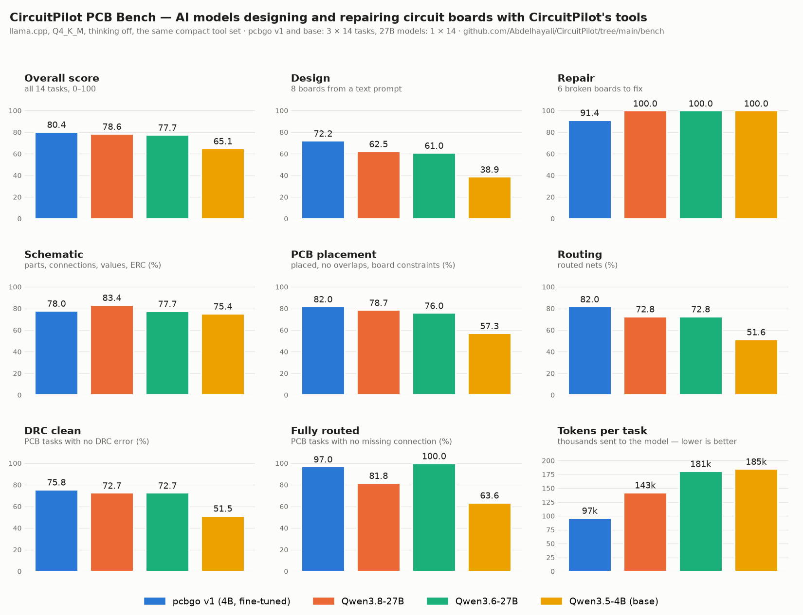

# CircuitPilot PCB Bench

How well can an AI model design and repair circuit boards **with CircuitPilot's tools**? The model gets a task
("make a 3.3 V supply on a 30 × 20 mm board with a GND pour"), works in the same agent loop as the app's AI Copilot
— CircuitPilot's real engine runs its tool calls — and the **design it leaves behind** is scored, not its words.



(`python bench/chart.py` redraws it from `bench/results/`.)

## Score (0–100 per task)
| Part | Points | What is checked |
|---|---|---|
| Schematic | 35 | required parts (10) · required connections, e.g. "LED in series with a resistor between a supply and GND", "regulator input and output each have a capacitor to GND" (15) · values, e.g. LED current, divider ratio, 555 frequency, op-amp gain (5) · ERC issues (5, −25 % each) |
| Placement | 15 | every part placed (5) · overlaps / outside the outline / on a hole (5, −20 % each) · requested board size, edge, pour, holes (5) |
| Routing | 25 | routed nets / all nets — unrouted nets are listed as **missing connections** |
| DRC | 15 | DRC errors (−25 % each) |
| Behaviour | 10 | ends with an answer within the step limit; −10 % per failed or malformed tool call |

Tasks without a PCB are scored on schematic + behaviour, scaled to 100.

## Tasks
**Design** (from an empty project): D1 LED indicator + PCB · D2 3.3 V supply, 30 × 20 mm, GND pour · D3 555 blinker with
4 mounting holes · D4 I2C sensor board, header on the edge · D5 relay driver · D6 op-amp gain 10 · D7 sensor node
(regulator + sensor + LED, 35 × 25 mm, pour) · D8 schematic-only divider + filter.
**Repair** (from a broken design): R1 missing connection · R2 unrouted nets · R3 overlapping parts · R4 DRC short ·
R5 wrong resistor value · R6 part outside the board.

## Run
```bash
node bench/pcb_bench.mjs --base http://localhost:11434/v1 --model qwen3.5:4b                 # Ollama (any OpenAI-compatible server)
node bench/pcb_bench.mjs --base https://openrouter.ai/api/v1 --model <id> --key <key>        # hosted models
node bench/pcb_bench.mjs --provider anthropic --model claude-sonnet-5-5 --key <key> --tools full
node bench/pcb_bench.mjs --board                                                              # rebuild LEADERBOARD.md
```
Options: `--tools compact|full` (compact = the 30-tool set small models get in the app; full = every tool) ·
`--only D1,R2` · `--repeat 3` (average over runs) · `--steps 24` · `--temperature 0` · `--label "name"`.
Part searches use the running CircuitPilot app when it answers on localhost:5173, otherwise the cached answers in
`finetune/cache/parts.json`, so every model sees the same parts. Routing effort is capped the same for all models.

**An agent without an API** (e.g. Claude in Claude Code): `--provider driver` waits on http://localhost:8099 for each step;
the agent answers with `node bench/drive.mjs reply '{"calls":[{"name":"run_erc","args":{}}]}'` (or `{"text": "…"}` to finish)
and gets back exactly what an API model gets (the task, the design, tool results capped at 3000 characters, 24 steps).
Tokens are estimated from the request size (characters / 3.6). Runs made this way are kept in `bench/reference/`,
not on the leaderboard.

**Tokens / task** is the average sent to the model (the whole conversation is re-sent at every step, so it grows with
the number of steps) and generated by it, per task: a cost and speed guide.

 (every task with its score, what failed, the unrouted nets, DRC
errors and the full tool trace) and the table in `bench/results/LEADERBOARD.md`.
